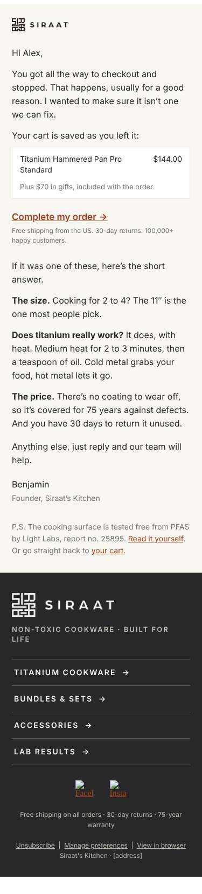
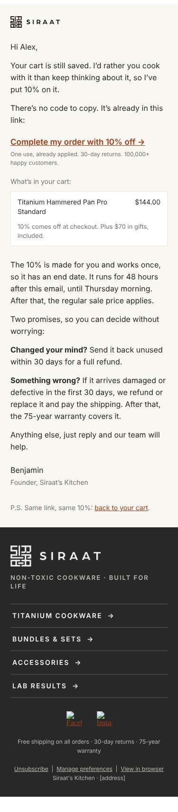
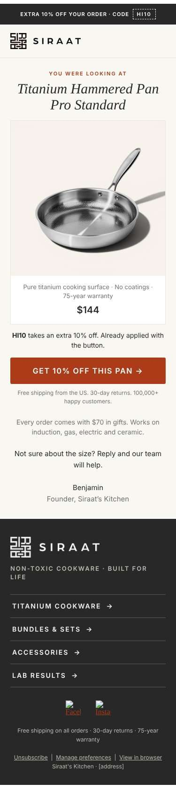
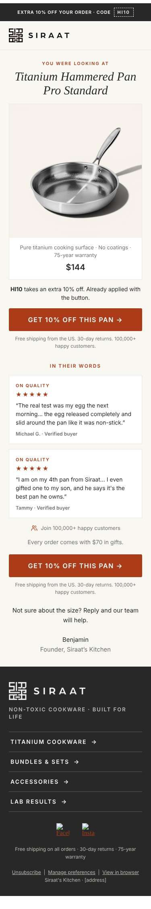

# 21 · Voorbeelden: persoonlijke checkoutmail en snellere browsemail (13 okt 2026)

Vraag Floris: voorbeelden van twee ideeen uit het concurrentenonderzoek (`research/concurrenten/overzicht.md`, ideeen 1 tot 3).

- **A. Persoonlijke checkoutmail** (Plateful: "persoonlijke factuur van Dannah", platte tekst, na 12,5 uur, 10% al in de link, 2 dagen geldig).
- **B. Snellere browsemail** (HexClad: 0,7 tot 1,5 uur na het bekijken, precies de bekeken pan groot in beeld).

Alleen lokaal gebouwd en gerenderd. **Niets in Klaviyo gewijzigd**: geen templates, geen flows, geen coupons, geen sends.

## Bestanden

| Variant | Bron | Klaviyo-HTML | Screenshot (375 px, Apple Mail-modus) |
|---|---|---|---|
| A1 persoonlijk, zonder korting | `klaviyo/templates/v3/voorbeelden/a1-persoonlijk.html` | `a1-persoonlijk.klaviyo.html` | `img/21-voorbeeld-A1.jpg` |
| A2 persoonlijk, korting in de link | `a2-persoonlijk-korting.html` | `a2-persoonlijk-korting.klaviyo.html` | `img/21-voorbeeld-A2.jpg` |
| B1 snel, compact productgericht | `b1-snel-product.html` | `b1-snel-product.klaviyo.html` | `img/21-voorbeeld-B1.jpg` |
| B2 snel, met korte social proof | `b2-snel-reviews.html` | `b2-snel-reviews.klaviyo.html` | `img/21-voorbeeld-B2.jpg` |

Gebouwd met `scripts/build_template.py` (vaste footer, preheader-fix, bgcolor-regels, light only). Previews (`*-preview.html`) zijn Django-renders op voorbeelddata: A op `co_x_standard.json` (Checkout Started, US, Titanium Hammered Pan Pro Standard, $144, met de 4 gifts in de cart), B op `vp_x_standard.json` met profielland US (Viewed Product, Pan Pro Standard, $144). Voornaam "Alex". Geen klantgegevens.

   

## Twee dingen die we vooraf al hebben

1. **HI10 zit al stil in de checkoutlinks van C1 t/m C3** (DECISIONS 2026-10-08). Een "10% in de link" zoals bij Plateful is dus voor Siraat niets nieuws in de eerste dagen. Het nieuwe aan A2 is de vorm (persoonlijk, geen code overtypen) en de persoonlijke unieke code met een echte einddatum. Daarom staat A2 op de plek van C4, waar die unieke 10%-code (pool C4_10_48H) al bestaat.
2. **B1 wacht in de v5-arm al 1 uur** (v4-flow-system 2.3, WdRz5k; de oude arm 10 minuten, zie 15-livewacht). "Sneller" is dus vooral: 45 minuten in plaats van 60, en het product veel groter en eerder in beeld. De huidige B1 toont de pan als miniatuur van 88 px onder een gemaakte hero; HexClad zet het bekeken product zelf bovenaan.

## A1 · Persoonlijke checkoutmail, zonder korting

- **Vorm**: brief van Benjamin. Klein logo-lockup als briefhoofd (104 px, links), geen banner, geen hero, geen navigatie. Korte alinea's, de cart als platte "factuur" (alleen betaalde regels, bedrag alleen bij USD, regel "Plus $70 in gifts, included with the order."), tekstlink in plaats van grote knop, handtekening "Benjamin / Founder, Siraat's Kitchen". Vaste footer blijft.
- **Inhoud**: drie korte antwoorden op de drie twijfels uit de enquête (maat, "werkt titanium echt", prijs met 75 jaar garantie en 30 dagen retour). Bij een accessoire-cart vervangt een cadeauregel dat blok. P.S. met Light Labs report no. 25895.
- **Onderwerp A**: `Alex, about your cart` (zonder voornaam: `About your cart`). **Onderwerp B**: `Something stop you at checkout?`. Andere typen in de topcomment.
- **Preview**: It's saved as you left it. If a question stopped you, here are the short answers.
- **Link**: `event.extra.responsive_checkout_url` met de stille HI10 erachter, zoals C1 t/m C3. De mail noemt geen korting.
- **Timing**: QUBUQV stap 3K, **als A/B-variant van C2** (24 uur na C1, alleen nieuwe klanten, kookgereipad). Zelfde plek, zelfde wachttijd, zelfde filters: het enige verschil is de vorm (persoonlijke brief tegenover de ontworpen C2 met hero, vergelijking en reviews).
- **Lengte**: ca. 150 woorden, 1.658 px op 375 px inclusief footer (C2 is ruim twee keer zo lang).

## A2 · Persoonlijke checkoutmail, korting al in de link

- **Vorm**: zelfde brief als A1. De korting staat bovenaan in de eerste alinea en de link: "There's no code to copy. It's already in this link." Daaronder de cart met "10% comes off at checkout", dan de eerlijke deadline ("made for you and works once, so it has an end date ... until {dag} morning. After that, the regular sale price applies.") en de twee beloftes (30 dagen retour ongebruikt; beschadigd of defect in 30 dagen: terugbetaling of vervanging, wij betalen verzending; daarna 75 jaar garantie).
- **Onderwerp A**: `10% off your cart, for 48 hours` (gelijk aan C4-US, zodat alleen de vorm verschilt). **Onderwerp B** voor een latere test: `I put 10% on your cart`.
- **Preview**: No code to type. It's already in the link, for 48 hours.
- **Link**: `responsive_checkout_url` + `&discount=` (zelfde vorm als de live C4, in de testrun bewezen). De code wordt nergens uitgeschreven, ook niet in de mail zelf. Een Shopify-discountlink `/discount/<code>?redirect=/cart` kan als terugval als er geen checkout-URL is; nu valt de link terug op `/checkout`.
- **Timing**: QUBUQV stap 6K, US-tak, code-arm A, **als A/B-variant van C4-US** (dag 5, 09:00). Zelfde code-pool, dus geen nieuwe coupon en de code-router en `last_flow_code_at` blijven gelijk.
- **Alternatief (Plateful-kopie)**: een extra C1b na ca. 12 uur met de korting erin. Niet aangeraden: HI10 zit dan al in de link, een tweede 10% binnen een dag leert klanten wachten, en de checkout-volumes zijn te klein voor nog een stap met eigen test.

## B1 · Snellere browsemail, compact en productgericht

- **Vorm**: codebalk HI10 en de **vaste header**, dan "YOU WERE LOOKING AT", de productnaam groot (live tekst, Instrument Serif Italic), **het beeld uit `event.ImageURL` op volle breedte** (Shopify `width=1200`), kenmerkregel "Pure titanium cooking surface · No coatings · 75-year warranty", prijs uit `event.Price` (alleen in eenduidige markten, browse-helper), regel "HI10 takes an extra 10% off. Already applied with the button.", knop "Get 10% off this pan" met friction reducer, één regel gifts en kookplaten, korte afsluiting van Benjamin. Geen gemaakte hero, geen verhaal, geen reviews.
- **Velden**: `event.Name` (zoals de live B1 en de echte Klaviyo onsite-events), terugval `event.ProductName`; `event.ImageURL`, `event.URL`, `event.Price`. Links via `/discount/HI10?redirect=<productpad>` met UTM `v4-browse` / `vb1-*`.
- **Onderwerp A**: `Still thinking about this pan?` **Onderwerp B**: `The pan you looked at, and why nothing's on it`.
- **Preview**: The one you were looking at, with 10% already applied.
- **Timing**: WdRz5k stap 1, **45 tot 60 minuten** na Viewed Product (XNtYMB), kookgereitak. Advies: eerst op 60 minuten testen tegen de huidige B1 (één variabele: de vorm), daarna pas een timingtest 45 tegen 60 minuten.
- **Lengte**: 1.696 px op 375 px; de pan en de knop staan boven de vouw.

## B2 · Snellere browsemail, met korte social proof

- **Vorm**: B1, plus direct onder de eerste knop twee echte Trustpilot-reviews over de Pan Pro (blok `reviews3`, letterlijk uit `content/reviews/top.md`, 5 sterren):
  - R169 Michael G.: "The real test was my egg the next morning... the egg released completely and slid around the pan like it was non-stick." (119 tekens)
  - R138 Tammy: "I am on my 4th pan from Siraat... I even gifted one to my son, and he says it's the best pan he owns." (101 tekens, verschil 18)
  - Daarna "Join 100,000+ happy customers", gifts-regel en een tweede knop.
- **Onderwerp A**: `Still thinking about this pan?` (gelijk aan B1). **Onderwerp B**: `"The egg released completely"` (letterlijk uit R169).
- **Preview**: Michael tried an egg the next morning. Tammy is on her 4th pan.
- **Timing**: als B1 (45 tot 60 minuten, WdRz5k stap 1).
- **Lengte**: 2.235 px op 375 px.

## Zo zouden we testen

Eén variabele per test, winnaar op unieke kliks, dan omzet per ontvanger, geen automatische winnaar, minimaal vier weken (PLAYBOOK 6).

| Test | Plek | Arm A (controle) | Arm B | Variabele | Opmerking |
|---|---|---|---|---|---|
| A-1 | QUBUQV 3K (C2) | huidige C2 | A1 | vorm (ontworpen tegenover persoonlijke brief) | onderwerp gelijk houden (C2-onderwerp A). Klein volume: alleen nieuwe klanten in het kookgereipad krijgen C2, dus reken op meer dan vier weken |
| A-2 | QUBUQV 6K US, code-arm A (C4-US) | huidige C4-US | A2 | vorm, zelfde code en onderwerp | pas na A-1, of tegelijk als Floris het checkoutvolume groot genoeg vindt (andere stap, andere ontvangers) |
| B-1 | WdRz5k stap 1, kookgereitak | huidige B1 | B1 nieuw | vorm (gemaakte hero + verhaal tegenover product groot) | 60 minuten, onderwerp gelijk. Let op de lopende T05a-onderwerptest op B1: eerst afronden of B-1 in de winnende onderwerpvariant zetten |
| B-2 | idem | winnaar B-1 | B2 | social proof erbij | |
| B-3 | idem | 60 minuten | 45 minuten | wachttijd | twee paden via een random split, zoals T01 |

Browse en checkout hebben elk al een T01-padsplit (oud tegenover v5). Deze tests lopen alleen in de v5-arm.

## Controles

- `mail_checks.preview_problems` en `bg_problems`: **0 en 0** op alle vier de Klaviyo-versies en op alle vier de renders.
- `qa_mail_shots.js` op 375 px, modus apple en gmailios (Chromium `/opt/pw-browsers/chromium`): geen horizontaal scrollen, geen afgesneden beelden, geen lege cellen, geen laag contrast; alle vier blijven licht. fb.png en ig.png melden "broken" in de simulatie, zoals bij elke mail met de vaste footer (19-review-hero).
- Geen ongerenderde `{{ }}`/`` in de renders, geen gedachtestreepje, geen kortingscode uitgeschreven (A2 gebruikt alleen de Klaviyo-tag van pool C4_10_48H). `research/copy/check_reviews.py`: 0 fouten.
- Claims: alleen uit de skill (pure titanium cooking surface + no coatings, Light Labs report no. 25895, 75-year warranty against defects, 30-day returns, 100,000+ happy customers). Geen levertijden.

## Open beslissingen voor Floris

1. **Briefhoofd bij A**: klein logo-lockup bovenaan (zoals gebouwd) of helemaal geen header. Beide wijken af van de vaste header; de vaste footer blijft. Nooit alleen het woordmerk.
2. **Knop of tekstlink bij A**: gebouwd als tekstlink (dat is het idee: het leest als een mail van een mens). PLAYBOOK zegt knoppen alleen via `BLOCK:cta`; dit is een bewuste uitzondering voor de test.
3. **HI10 in A1**: stil in de link houden (zoals C1 t/m C3, gebouwd) of weglaten.
4. **A2 op de plek van C4-US** (aangeraden, zelfde code-pool) of als extra C1b na ca. 12 uur zoals Plateful.
5. **B-volgorde**: eerst B-1 (vorm) op 60 minuten, en wat er gebeurt met de lopende T05a-onderwerptest op B1.
6. Na akkoord: export via `export_klaviyo.py` (dry-run, dan live), testmail met uniek onderwerp, dan pas de A/B in de flow.
